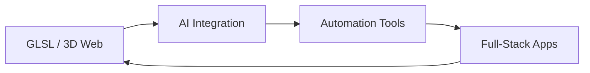

<!--
  Profile README — Vineet Kumar (void032)
  Assets live in /assets (generated SVGs, dark + light variants)
-->
<div align="center">

<picture>
  <source media="(prefers-color-scheme: dark)" srcset="assets/header-dark.svg">
  <source media="(prefers-color-scheme: light)" srcset="assets/header-light.svg">
  
</picture>

<picture>
  <source media="(prefers-color-scheme: dark)" srcset="assets/terminal-dark.svg">
  <source media="(prefers-color-scheme: light)" srcset="assets/terminal-light.svg">
  
</picture>

<br>


<a href="https://shader-studio-teal.vercel.app"></a>
<a href="https://www.linkedin.com/in/void032"></a>

</div>

<br>

<picture>
  <source media="(prefers-color-scheme: dark)" srcset="assets/sec-about-dark.svg">
  <source media="(prefers-color-scheme: light)" srcset="assets/sec-about-light.svg">
  
</picture>

> **I build tools that eliminate friction — from AI automation to real-time 3D shaders.**

I'm a full-stack developer who bridges **practical utility** and **visual craft**. Whether it's a desktop video splitter, a browser shader studio, or an AI automation pipeline, I focus on shipping polished, performant tools.

```yaml
name:     Vineet Kumar
alias:    void032
focus:    Creative Dev, 3D Web, GLSL, Developer Tools, AI Automation
location: Behind a screen, shipping code
stack:    React, Three.js, Python, Node.js, GLSL
```

<br>

<picture>
  <source media="(prefers-color-scheme: dark)" srcset="assets/sec-projects-dark.svg">
  <source media="(prefers-color-scheme: light)" srcset="assets/sec-projects-light.svg">
  
</picture>

<table>
  <tr>
    <td width="50%" valign="top">
      <h3><a href="https://github.com/void032/shader-studio">Universal Shader Studio</a></h3>
      <p>Browser-based GLSL editor — real-time, zero setup, open source. Procedural terrain, GLB drag-and-drop, live vertex + fragment editing, multi-target export.</p>
      <p>  </p>
      <p><a href="https://shader-studio-teal.vercel.app">Live demo</a> · <a href="https://github.com/void032/shader-studio">Source</a></p>
    </td>
    <td width="50%" valign="top">
      <h3>SplitKit</h3>
      <p>Auto-split long videos with dual processing modes — Fast Copy (lossless) and Re-encode. Bundled with FFmpeg, ready-to-use installer.</p>
      <p>  </p>
      <p><sub>Desktop app · Threading</sub></p>
    </td>
  </tr>
  <tr>
    <td width="50%" valign="top">
      <h3>Image Downloader Pro</h3>
      <p>Intelligent bulk image downloader Chrome extension. Detects &lt;img&gt; tags, CSS backgrounds, and lazy-loaded content, with batch processing.</p>
      <p> </p>
      <p><sub>Extension · Chrome APIs · Batch download</sub></p>
    </td>
    <td width="50%" valign="top">
      <h3>Python Image Scraper</h3>
      <p>Headless browser automation for authenticated image scraping. Reuses existing Chrome profiles, handles lazy-loading, deduplicates, and organizes files.</p>
      <p> </p>
      <p><sub>CLI tool · Auth · Threading</sub></p>
    </td>
  </tr>
</table>

<details>
<summary><b>Shader Studio — features, tech stack &amp; architecture</b></summary>

<br>

- **Procedural terrain** — Perlin and Island generators
- **GLB upload** — drag and drop
- **Live GLSL** — vertex + fragment editing
- **Multi-export** — Three.js · R3F · raw GLSL · vanilla WebGL

| Layer | Technology |
|---|---|
| Renderer | Three.js r168 |
| Framework | React 18 + Vite 7 |
| Styling | Tailwind CSS v3 + shadcn/ui |
| Shaders | Raw GLSL (vertex + fragment) |
| Models | GLTFLoader + BufferGeometryUtils |
| Terrain | Custom Perlin noise implementation |
| Export | Three.js · R3F · Raw GLSL · Vanilla WebGL |

```
src/
├── components/
│   ├── scene/          # Terrain, Primitive, GLB controls
│   ├── tabs/           # Scene | Shader | Export | Code
│   └── ui/             # shadcn + custom components
├── context/
│   └── StudioContext   # Global state management
├── hooks/
│   ├── useThreeScene   # Scene lifecycle
│   ├── useShaderCompiler
│   ├── useTerrain      # Procedural generation
│   └── useGLBLoader    # Model ingestion
└── lib/
    ├── shaderPresets   # Built-in GLSL templates
    ├── codeTemplates   # Export generators
    └── colorPresets    # Terrain themes
```

</details>

<br>

<picture>
  <source media="(prefers-color-scheme: dark)" srcset="assets/sec-stack-dark.svg">
  <source media="(prefers-color-scheme: light)" srcset="assets/sec-stack-light.svg">
  
</picture>

**3D / Graphics**<br>


**Languages & Frontend**<br>


**AI & Agents**<br>


**Tools & Platforms**<br>


<br>

<picture>
  <source media="(prefers-color-scheme: dark)" srcset="assets/sec-analytics-dark.svg">
  <source media="(prefers-color-scheme: light)" srcset="assets/sec-analytics-light.svg">
  
</picture>

<div align="center">
  
  
</div>

<div align="center">

<picture>
  <source media="(prefers-color-scheme: dark)" srcset="https://streak-stats.demolab.com/?user=void032&hide_border=true&stroke=30363d&background=0d1117&ring=58a6ff&fire=2DD4BF&currStreakNum=f0f6fc&sideNums=f0f6fc&currStreakLabel=58a6ff&sideLabels=8b949e&dates=6e7681">
  <source media="(prefers-color-scheme: light)" srcset="https://streak-stats.demolab.com/?user=void032&hide_border=true&stroke=d1d9e0&background=ffffff&ring=0969da&fire=0d9488&currStreakNum=1f2328&sideNums=1f2328&currStreakLabel=0969da&sideLabels=59636e&dates=818b98">
  
</picture>

<picture>
  <source media="(prefers-color-scheme: dark)" srcset="https://github-readme-activity-graph.vercel.app/graph?username=void032&theme=github-compact&hide_border=true&area=true&bg_color=0d1117&color=58a6ff&line=2DD4BF&point=58a6ff">
  <source media="(prefers-color-scheme: light)" srcset="https://github-readme-activity-graph.vercel.app/graph?username=void032&hide_border=true&area=true&bg_color=ffffff&color=0969da&line=0d9488&point=0969da&title_color=1f2328">
  
</picture>

</div>

<br>

<picture>
  <source media="(prefers-color-scheme: dark)" srcset="assets/sec-exploring-dark.svg">
  <source media="(prefers-color-scheme: light)" srcset="assets/sec-exploring-light.svg">
  
</picture>



- **3D Web & Shaders** — cinematic scroll-driven experiences with Three.js + GSAP + GLSL
- **AI-Powered Solutions** — integrating LLMs into practical applications
- **Process Automation** — eliminating manual, repetitive tasks
- **Developer Tools** — utilities that ship fast and work clean

<br>

<picture>
  <source media="(prefers-color-scheme: dark)" srcset="assets/sec-connect-dark.svg">
  <source media="(prefers-color-scheme: light)" srcset="assets/sec-connect-light.svg">
  
</picture>

<div align="center">

<a href="https://www.linkedin.com/in/void032"></a>
<a href="https://github.com/void032"></a>
<a href="mailto:vineetkumar1639@gmail.com"></a>
<a href="https://shader-studio-teal.vercel.app"></a>

<br><br>

<sub><i>The best code is the code that solves real problems efficiently.</i></sub>

</div>
