<!-- Profile README — Vineet Kumar (void032) · assets/ = static SVGs · profile/ = generated by .github/workflows/profile-stats.yml -->
<div align="center">

<picture>
  <source media="(prefers-color-scheme: dark)" srcset="assets/header-dark.svg">
  <source media="(prefers-color-scheme: light)" srcset="assets/header-light.svg">
  
</picture>

<picture>
  <source media="(prefers-color-scheme: dark)" srcset="assets/terminal-dark.svg">
  <source media="(prefers-color-scheme: light)" srcset="assets/terminal-light.svg">
  
</picture>

<br>


<a href="https://shader-studio-teal.vercel.app"></a>
<a href="https://www.linkedin.com/in/void032"></a>

</div>

<br>

<picture>
  <source media="(prefers-color-scheme: dark)" srcset="assets/sec-about-dark.svg">
  <source media="(prefers-color-scheme: light)" srcset="assets/sec-about-light.svg">
  
</picture>
<picture>
  <source media="(prefers-color-scheme: dark)" srcset="assets/about-dark.svg">
  <source media="(prefers-color-scheme: light)" srcset="assets/about-light.svg">
  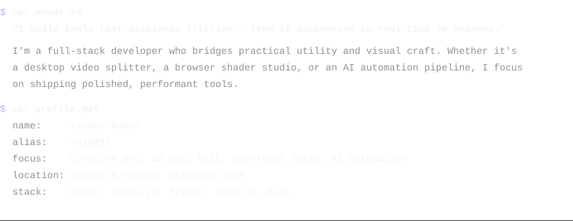
</picture>

<br>

<picture>
  <source media="(prefers-color-scheme: dark)" srcset="assets/sec-projects-dark.svg">
  <source media="(prefers-color-scheme: light)" srcset="assets/sec-projects-light.svg">
  
</picture>
<a href="https://github.com/void032/shader-studio">
<picture>
  <source media="(prefers-color-scheme: dark)" srcset="assets/project1-dark.svg">
  <source media="(prefers-color-scheme: light)" srcset="assets/project1-light.svg">
  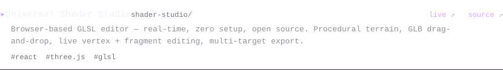
</picture>
</a>
<picture>
  <source media="(prefers-color-scheme: dark)" srcset="assets/project2-dark.svg">
  <source media="(prefers-color-scheme: light)" srcset="assets/project2-light.svg">
  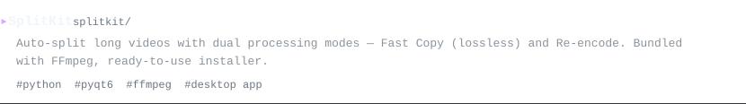
</picture>
<picture>
  <source media="(prefers-color-scheme: dark)" srcset="assets/project3-dark.svg">
  <source media="(prefers-color-scheme: light)" srcset="assets/project3-light.svg">
  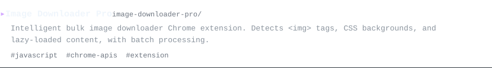
</picture>
<picture>
  <source media="(prefers-color-scheme: dark)" srcset="assets/project4-dark.svg">
  <source media="(prefers-color-scheme: light)" srcset="assets/project4-light.svg">
  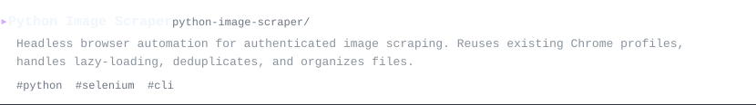
</picture>

<details>
<summary><b>Universal Shader Studio — features, tech stack &amp; architecture</b></summary>

<br>

- **Procedural terrain** — Perlin and Island generators
- **GLB upload** — drag and drop
- **Live GLSL** — vertex + fragment editing
- **Multi-export** — Three.js · R3F · raw GLSL · vanilla WebGL

```yaml
renderer:  Three.js r168
framework: React 18 + Vite 7
styling:   Tailwind CSS v3 + shadcn/ui
shaders:   Raw GLSL (vertex + fragment)
models:    GLTFLoader + BufferGeometryUtils
terrain:   Custom Perlin noise implementation
export:    Three.js · R3F · Raw GLSL · Vanilla WebGL
```

```
src/
├── components/
│   ├── scene/          # Terrain, Primitive, GLB controls
│   ├── tabs/           # Scene | Shader | Export | Code
│   └── ui/             # shadcn + custom components
├── context/
│   └── StudioContext   # Global state management
├── hooks/
│   ├── useThreeScene   # Scene lifecycle
│   ├── useShaderCompiler
│   ├── useTerrain      # Procedural generation
│   └── useGLBLoader    # Model ingestion
└── lib/
    ├── shaderPresets   # Built-in GLSL templates
    ├── codeTemplates   # Export generators
    └── colorPresets    # Terrain themes
```

[Live demo](https://shader-studio-teal.vercel.app) · [Source](https://github.com/void032/shader-studio)

</details>

<br>

<picture>
  <source media="(prefers-color-scheme: dark)" srcset="assets/sec-stack-dark.svg">
  <source media="(prefers-color-scheme: light)" srcset="assets/sec-stack-light.svg">
  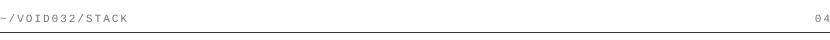
</picture>
<picture>
  <source media="(prefers-color-scheme: dark)" srcset="assets/stack-dark.svg">
  <source media="(prefers-color-scheme: light)" srcset="assets/stack-light.svg">
  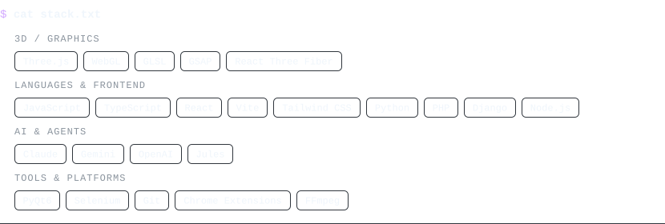
</picture>

<br>

<picture>
  <source media="(prefers-color-scheme: dark)" srcset="assets/sec-analytics-dark.svg">
  <source media="(prefers-color-scheme: light)" srcset="assets/sec-analytics-light.svg">
  
</picture>
<picture>
  <source media="(prefers-color-scheme: dark)" srcset="profile/stats-dark.svg">
  <source media="(prefers-color-scheme: light)" srcset="profile/stats-light.svg">
  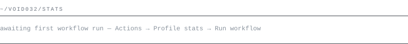
</picture>
<picture>
  <source media="(prefers-color-scheme: dark)" srcset="profile/activity-dark.svg">
  <source media="(prefers-color-scheme: light)" srcset="profile/activity-light.svg">
  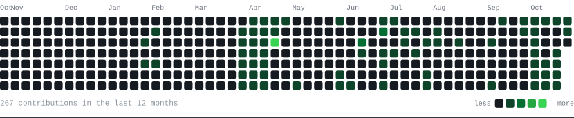
</picture>

<br>

<picture>
  <source media="(prefers-color-scheme: dark)" srcset="assets/sec-exploring-dark.svg">
  <source media="(prefers-color-scheme: light)" srcset="assets/sec-exploring-light.svg">
  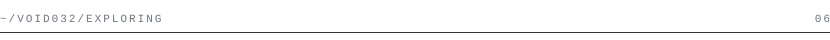
</picture>
<picture>
  <source media="(prefers-color-scheme: dark)" srcset="assets/exploring-dark.svg">
  <source media="(prefers-color-scheme: light)" srcset="assets/exploring-light.svg">
  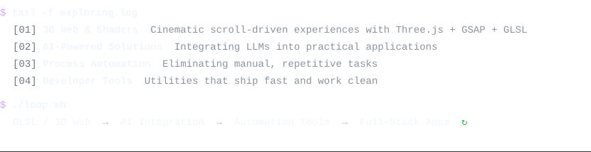
</picture>

<br>

<picture>
  <source media="(prefers-color-scheme: dark)" srcset="assets/sec-connect-dark.svg">
  <source media="(prefers-color-scheme: light)" srcset="assets/sec-connect-light.svg">
  
</picture>

<div align="center">

<a href="https://www.linkedin.com/in/void032">
<picture>
  <source media="(prefers-color-scheme: dark)" srcset="assets/btn-linkedin-dark.svg">
  <source media="(prefers-color-scheme: light)" srcset="assets/btn-linkedin-light.svg">
  
</picture>
</a>
<a href="https://github.com/void032">
<picture>
  <source media="(prefers-color-scheme: dark)" srcset="assets/btn-github-dark.svg">
  <source media="(prefers-color-scheme: light)" srcset="assets/btn-github-light.svg">
  
</picture>
</a>
<a href="mailto:vineetkumar1639@gmail.com">
<picture>
  <source media="(prefers-color-scheme: dark)" srcset="assets/btn-email-dark.svg">
  <source media="(prefers-color-scheme: light)" srcset="assets/btn-email-light.svg">
  
</picture>
</a>
<a href="https://shader-studio-teal.vercel.app">
<picture>
  <source media="(prefers-color-scheme: dark)" srcset="assets/btn-shader-studio-dark.svg">
  <source media="(prefers-color-scheme: light)" srcset="assets/btn-shader-studio-light.svg">
  
</picture>
</a>

</div>

<picture>
  <source media="(prefers-color-scheme: dark)" srcset="assets/quote-dark.svg">
  <source media="(prefers-color-scheme: light)" srcset="assets/quote-light.svg">
  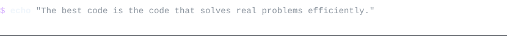
</picture>
